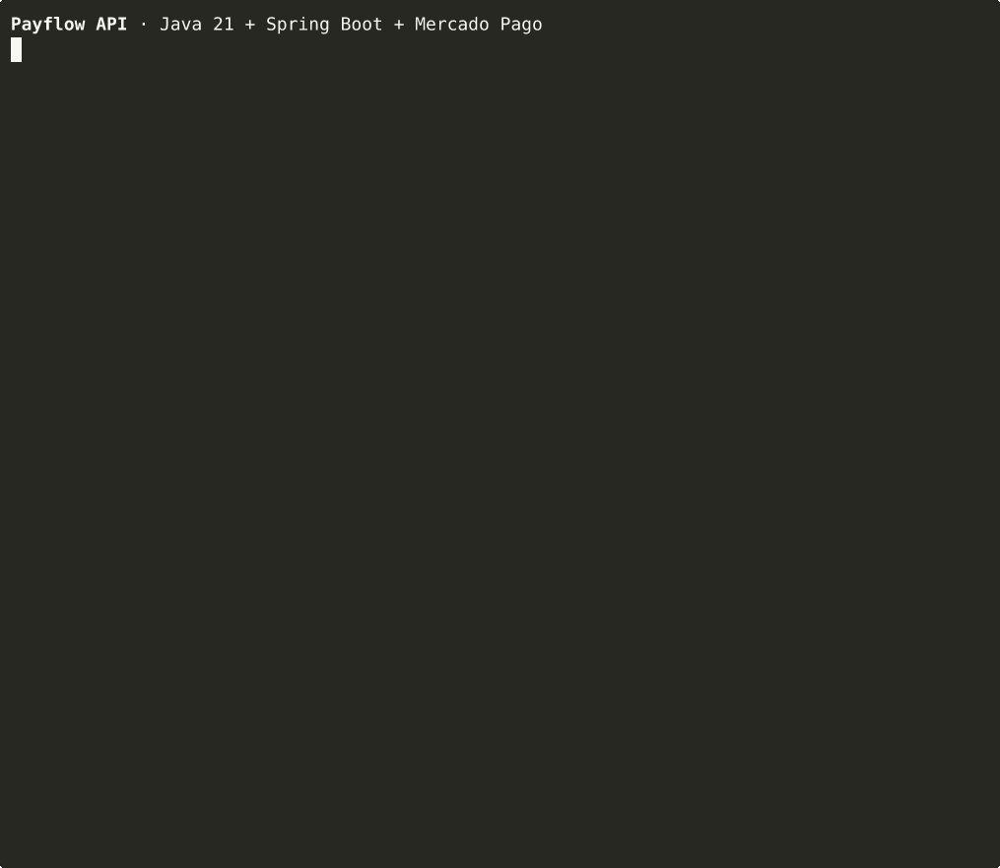
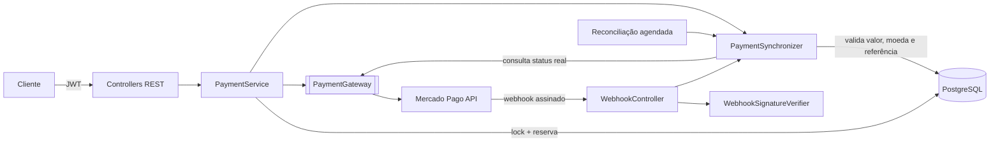
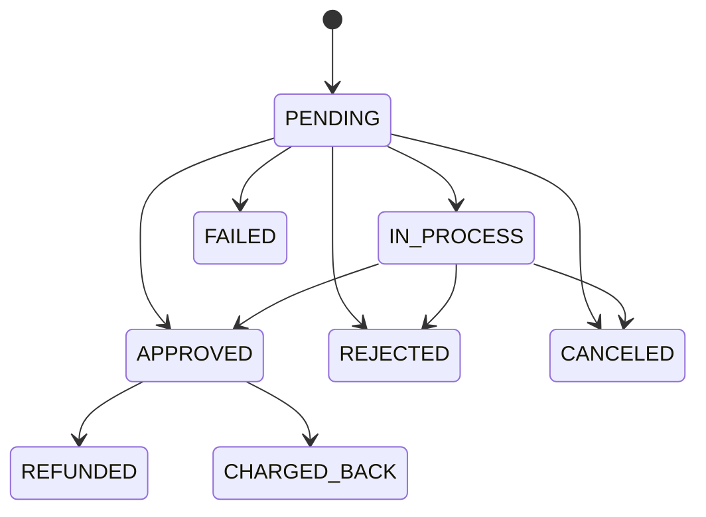

# Payflow API

[](../../actions/workflows/ci.yml)

Backend de pedidos e pagamentos em **Java 21 + Spring Boot 3**, integrado ao **Mercado Pago**. Aceita **Pix**, **cartão de crédito** (com parcelamento), **boleto** e **assinaturas recorrentes**, com foco em um ponto que costuma ser negligenciado: **nunca confirmar um pagamento sem validá-lo de ponta a ponta**.

## Demonstração



Fluxo completo de um pagamento Pix: cadastro e login, criação do pedido, cobrança com `Idempotency-Key`, clique duplicado sem nova cobrança, webhook forjado recusado e webhook assinado aprovando o pedido. A gravação é feita pelo workflow [`demo.yml`](.github/workflows/demo.yml) com a API rodando sobre PostgreSQL e o Mercado Pago simulado por WireMock (roteiro em [`demo/demo.sh`](demo/demo.sh)). [Versão em MP4](docs/demo.mp4).

## O que o projeto resolve

Integrar um gateway de pagamento parece simples até aparecerem os casos reais: o cliente clica duas vezes no botão, o webhook chega fora de ordem (ou não chega), alguém forja uma notificação, o valor cobrado não bate com o pedido. Esta API trata cada um desses cenários:

| Risco | Como é tratado |
|---|---|
| Cobrança duplicada por clique duplo ou retry | Cabeçalho `Idempotency-Key` obrigatório, chave única por cliente no banco e repassada ao Mercado Pago como `X-Idempotency-Key` |
| Dois pagamentos simultâneos para o mesmo pedido | Lock pessimista no pedido + regra de um pagamento ativo por vez |
| Valor manipulado pelo cliente | O valor nunca vem da requisição: é sempre o total calculado no servidor a partir do catálogo |
| Webhook forjado | Validação HMAC-SHA256 do cabeçalho `x-signature`, comparação em tempo constante e janela de tolerância contra replay |
| Payload de webhook adulterado | O conteúdo da notificação é ignorado; o status é sempre consultado direto na API do provedor |
| Divergência de valor, moeda ou referência | O pagamento não é aprovado, o pedido vai para `PAYMENT_REVIEW` e a divergência fica registrada na auditoria |
| Webhook perdido | Job de reconciliação revisa pagamentos parados e consulta o provedor (inclusive por `external_reference` quando a resposta original se perdeu) |
| Notificações fora de ordem | Máquina de estados impede transições inválidas (ex.: `APPROVED` nunca volta para `PENDING`) |
| Webhook repetido | Deduplicação por `x-request-id` |

## Arquitetura



O domínio conversa com o provedor apenas pela interface `PaymentGateway`. O `MercadoPagoClient` é a implementação atual, feita com `RestClient` puro (sem SDK), o que deixa explícito cada contrato HTTP e facilita testar com `MockRestServiceServer`.

Toda mudança de status, venha da resposta síncrona, do webhook, da reconciliação ou de uma ação administrativa, passa pelo `PaymentSynchronizer`, que é o único ponto do sistema capaz de aprovar um pedido.

### Fluxo de um pagamento

1. `POST /payments/pix` com `Idempotency-Key`.
2. Em uma transação curta, o pedido é bloqueado, as regras são verificadas e o pagamento é reservado como `PENDING`.
3. A chamada ao Mercado Pago acontece **fora** da transação, para não segurar conexões do banco durante I/O externo.
4. A resposta é validada e aplicada. Erro 4xx do provedor marca o pagamento como `FAILED` e libera nova tentativa; erro 5xx ou timeout mantém `PENDING` e a reconciliação resolve depois.
5. Quando o cliente paga, o Mercado Pago envia o webhook, a assinatura é conferida, o status é consultado na API e o pedido passa para `PAID`.

### Máquina de estados



## Stack

- Java 21, Spring Boot 3.5 (Web, Data JPA, Security, Validation, Actuator)
- PostgreSQL 16 + Flyway
- JWT (jjwt) com BCrypt
- OpenAPI / Swagger UI (springdoc)
- JUnit 5, Mockito, MockMvc, MockRestServiceServer, H2 para testes, JaCoCo
- Docker multi-stage, Docker Compose e GitHub Actions

## Como rodar

### Com Docker

```bash
cp .env.example .env   # preencha com suas credenciais de teste do Mercado Pago
docker compose up --build
```

A API sobe em `http://localhost:8080` e a documentação interativa fica em `http://localhost:8080/docs`.

### Localmente

```bash
docker compose up -d postgres
export MP_ACCESS_TOKEN=TEST-...
export MP_WEBHOOK_SECRET=...
mvn spring-boot:run
```

### Testes

```bash
mvn verify
```

O relatório de cobertura é gerado em `target/site/jacoco/index.html`.

## Configuração

| Variável | Descrição |
|---|---|
| `MP_ACCESS_TOKEN` | Access token do Mercado Pago (use o de teste no desenvolvimento) |
| `MP_WEBHOOK_SECRET` | Chave secreta exibida no painel de webhooks do Mercado Pago |
| `MP_NOTIFICATION_URL` | URL pública que receberá os webhooks (`/webhooks/mercadopago`) |
| `JWT_SECRET` | Segredo HMAC dos tokens, com no mínimo 32 caracteres |
| `ADMIN_EMAIL`, `ADMIN_PASSWORD`, `ADMIN_DOCUMENT` | Cria o administrador inicial na primeira execução |
| `DB_URL`, `DB_USER`, `DB_PASSWORD` | Conexão com o PostgreSQL |

Para receber webhooks em ambiente local, exponha a porta 8080 com uma ferramenta de túnel (ngrok, Cloudflare Tunnel) e cadastre a URL no painel do Mercado Pago.

## Endpoints

| Método | Rota | Descrição |
|---|---|---|
| `POST` | `/auth/register` | Cadastro de cliente (CPF validado) |
| `POST` | `/auth/login` | Retorna o token JWT |
| `GET` | `/me` | Dados do usuário autenticado |
| `GET` | `/products` | Catálogo público, paginado |
| `POST` / `PUT` | `/products`, `/products/{id}` | Gestão do catálogo (admin) |
| `POST` | `/orders` | Cria um pedido; o total é calculado no servidor |
| `GET` | `/orders`, `/orders/{id}` | Pedidos do cliente |
| `POST` | `/orders/{id}/cancel` | Cancela um pedido sem pagamento em andamento |
| `POST` | `/payments/pix` | Gera QR Code e código copia e cola |
| `POST` | `/payments/card` | Pagamento com cartão tokenizado (até 12x) |
| `POST` | `/payments/boleto` | Emite boleto com linha digitável |
| `GET` | `/payments/{id}` | Consulta um pagamento |
| `POST` | `/payments/{id}/refresh` | Atualiza o status direto no provedor |
| `POST` | `/payments/{id}/cancel` | Cancela Pix ou boleto ainda não pago |
| `POST` | `/payments/{id}/refund` | Estorno (admin) |
| `GET` | `/payments/{id}/history` | Trilha de auditoria (admin) |
| `GET` | `/orders/{id}/payments` | Tentativas de pagamento do pedido |
| `POST` | `/subscriptions` | Cria assinatura recorrente no cartão |
| `GET` | `/subscriptions`, `/subscriptions/{id}` | Assinaturas do cliente |
| `POST` | `/subscriptions/{id}/pause` · `/resume` · `/cancel` | Gerencia a assinatura |
| `POST` | `/webhooks/mercadopago` | Notificações de pagamento e assinatura |

Erros seguem o padrão [RFC 9457 (Problem Details)](https://www.rfc-editor.org/rfc/rfc9457) com um campo `code` estável para o front-end tratar.

### Exemplo: pagamento com Pix

```bash
TOKEN=$(curl -s localhost:8080/auth/login -H 'Content-Type: application/json' \
  -d '{"email":"maria@example.com","password":"senha-forte-1"}' | jq -r .accessToken)

ORDER=$(curl -s localhost:8080/orders -H "Authorization: Bearer $TOKEN" -H 'Content-Type: application/json' \
  -d '{"items":[{"productId":"749990f6-6ccd-40b3-ab75-e8061a3fee9f","quantity":1}]}' | jq -r .id)

curl -s localhost:8080/payments/pix -H "Authorization: Bearer $TOKEN" \
  -H "Idempotency-Key: $(uuidgen)" -H 'Content-Type: application/json' \
  -d "{\"orderId\":\"$ORDER\"}" | jq
```

```json
{
  "id": "4f1c2b9e-...",
  "orderId": "a83d...",
  "method": "PIX",
  "status": "PENDING",
  "statusDetail": "pending_waiting_transfer",
  "amount": 150.00,
  "installments": 1,
  "providerId": "1325467890",
  "pix": {
    "qrCode": "00020126580014br.gov.bcb.pix...",
    "qrCodeBase64": "iVBORw0KGgoAAAANSUhEUgAA...",
    "ticketUrl": "https://www.mercadopago.com.br/payments/1325467890/ticket"
  },
  "expiresAt": "2026-10-16T13:30:00Z"
}
```

### Cartão de crédito

Os dados do cartão nunca passam por este backend. O front-end usa o SDK JS do Mercado Pago (Card Payment Brick ou `createCardToken`) para gerar um token de uso único, e só esse token é enviado para `/payments/card`. Isso mantém a aplicação fora do escopo mais pesado do PCI DSS.

## Estrutura

```
src/main/java/com/payflow
├── auth            # cadastro, login, JWT
├── catalog         # produtos
├── order           # pedidos e itens
├── payment
│   ├── api         # controllers e DTOs
│   ├── application # serviço, sincronização e reconciliação
│   ├── domain      # entidades, status e auditoria
│   └── gateway     # porta de saída + implementação Mercado Pago
├── subscription    # assinaturas recorrentes (preapproval)
├── webhook         # recepção e validação de notificações
├── shared          # exceções e validações (CPF)
└── config          # segurança, OpenAPI, relógio
```

## Licença

MIT
